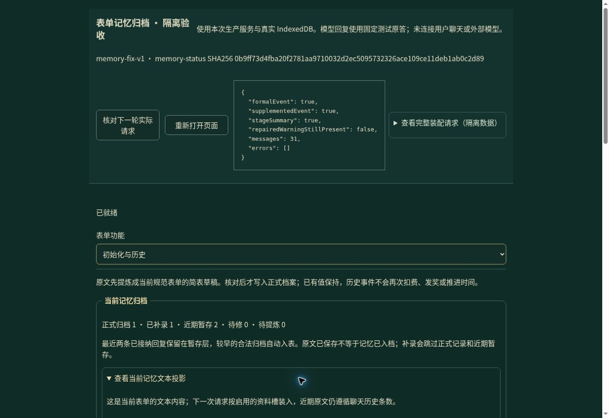

# 表单记忆归档修复 · candidate.35-memory.1

基线 main `2cddecbb73bac4fb2e9b94a7eba9e6c6eacded36`，与本地父提交 `8f8e5c7d86681b22075d575ffdea9866ae28b846` 文件树一致。此版本是本地候选，尚未更新 main；不包含小手机改造。

## 实际故障与修复

1. 历史补录的预览校验允许自动来源字段为空，但正式保存把这些只读字段也当作用户必填字段，产生 `REQUIRED_FIELD / T_DYN_EVENTS.source_entry_id`。正式保存现与共享表单校验对齐：只要求可填写的必填项，仍拒绝手工伪造只读来源；标题缺失仍失败。
2. 某些页面把原文来源已保存当成正式归档，补录服务又不识别自动归档。现在共用只读来源状态，区分正式归档、已补录、近期暂存、待修和来源变化。已正式入档或暂存中的来源不会重复提炼；在草稿核对期间已自动入档的来源也拒绝重复保存。
3. 历史补录白名单缺少阶段摘要等已有 archive 表。现使用同一份归档表清单，复用原有提炼、规范表单提交和文本槽。没有增加另一套记忆数据库。
4. 原始资料完整保留；发给历史提炼的正文去除 task/cells/archive/anchor 等机器块，包含所选回复前的用户上下文。多段旧日志的正文和中间用户文字保留。
5. 已核对补录的来源不再保留过时的“记忆待核”注入提示；原始归档错误和来源并未删除。来源改变或分支回滚仍撤销对应补录，避免旧记忆继续注入。
6. 现有“初始化与历史”页面显示来源状态、待修理由和当前事件/阶段摘要/认知文本投影；明确区分当前投影与实际发送请求。

## 使用与原有契约

入口：缇斯亚助手 → 角色卡建表与记忆归档（表单功能：初始化与历史）。正常回复保持原有两层规则：原文立即保存，最新两条已接纳回复暂存，较早的合法 archive 进入正式表单。当前状态仍由 cells 即时更新。缺失或错误归档可选择楼层提炼，核对草稿后补录。

正式档案按原有事件记忆、阶段摘要和人物认知资料槽文本化，继续受原资料槽启用设置、字段可见性与角色认知范围约束。页面文本投影仅展示当前表单内容；实际请求结果另用生产 before/payloadReady 链路核验。

## 验证结果

- `npm test`：18 项生成一致性检查、2638/2638 测试通过，exit 0；无跳过。
- 归档专项：30/30 通过。新增真实生产服务场景覆盖自动归档与补录去重、只读来源保护、IndexedDB 保存冲突后重试、幂等保存、冷重开、原文修改后撤销旧记忆、多段正文清洗、阶段摘要与事件进入最终请求。
- 官方 sites-preview + 云 Chromium：实际点击生成草稿、核对并保存事件和阶段摘要，重载页面仍为“正式归档 1、已补录 1、近期暂存 2、待修 0”；再次补录被拒绝且记录未增加。真实 IndexedDB，使用隔离合成聊天和固定模型回复。
- 实际 before/payloadReady 生成的 31 条请求消息包含自动事件、补录事件和阶段摘要，修复来源的旧告警不再出现。页面错误列表为空。浏览器日志中仅见云浏览器扩展元数据错误，来源为 chrome-extension://，未将其报告为项目错误。
- 未验证真实宿主、外部模型生成质量或 Android 真机；此处不把云浏览器或模拟宿主算作这些验收。

## 可复核证据

[memory-archive-20261115/validation.json](memory-archive-20261115/validation.json)；[完整回归日志](memory-archive-20261115/full-tests.log)；[修复前复现](memory-archive-20261115/before-fix.log)；[专项测试](memory-archive-20261115/targeted-tests.log)；[实际请求](memory-archive-20261115/request-report.json)；[源码清单](memory-archive-20261115/source-manifest.json)。源码清单覆盖 1905 个文件，排除本次证据文档以避免自引用；最终提交另保存完整 Git 树。

